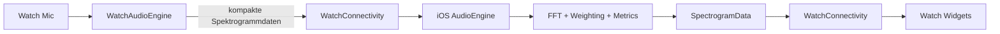
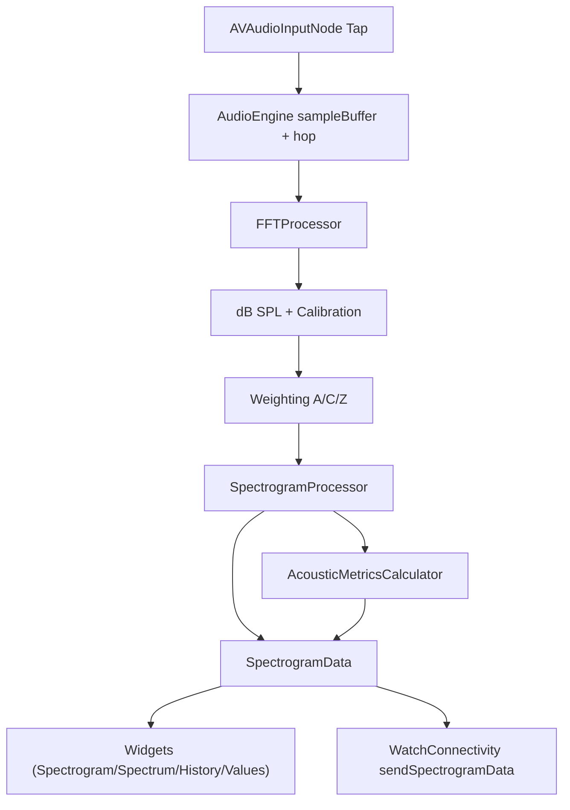

# SpektoWatch2 Architekturüberblick

Stand: 2026-11-26 (vormals `FULLSTACK_UEBERSICHT.md`)
Repo: `SpektoWatch2` (iOS + watchOS, Swift/SwiftUI)

## 1) Stack auf einen Blick

- Sprache/UI: Swift, SwiftUI
- Audio/DSP: AVFoundation, Accelerate/vDSP
- Rendering: Metal/MetalKit (Live- und Playback-Spektrogramm)
- Kommunikation: WatchConnectivity
- State/Reactive: Combine, `@Published`, `EnvironmentObject`
- Logging/Profiling: `OSLog`, `os_signpost`, Diagnose-Flags via Scheme-Env
- Tests: XCTest (Unit, Integration, UI), SnapshotTesting, `TestPlans/*.xctestplan`, `docs/test-plans/`, `run_tests.sh`

## 2) Targets und Projektstruktur

### Targets
- `SpektoWatch2` (iOS App)
- `SpektoWatch Watch App` (watchOS App)
- `SpektoWatch2WidgetExtension` (iOS Live Activity)
- `SpektoWatch Complications` (watchOS WidgetKit Extension)
- `SpektoWatch2Tests` / `SpektoWatch2UITests` / `SpektoWatchTests`

### Hauptordner
- `SpektoWatch2/` iOS-UI, AudioEngine, DSP, Renderer, Widget-System
- `SpektoWatch Watch App/` watch-UI und WatchAudioEngine
- `Shared/` gemeinsame Payloads, Mapping, Notifications, Logging

### Wichtiger Build-Mechanismus
Das Projekt nutzt **filesystem-synced groups** in `project.pbxproj` mit `PBXFileSystemSynchronizedBuildFileExceptionSet`.  
Damit werden einzelne Dateien trotz gleicher Namen gezielt aus Targets ausgeschlossen (wichtig bei Legacy-Duplikaten).

## 3) Laufzeit-Architektur (iOS)

### App Bootstrap
- Entry: `SpektoWatch2/SpektoWatch2App.swift` → `ContentView`
- Dependency Injection über `AppServices` (`SpektoWatch2/AppServices.swift`):
  - sofort: `BandstopFilterManager`, `WatchConnectivityManager`,
    `RecordingManager`, `FFTConfiguration`, `MaskingProfileManager`
  - verzögert (structured concurrency in `startAudio()`): `AudioEngine`,
    `MaskingEngine`
- `AudioEngine` ist eine Fassade über `AudioCaptureSession`,
  `ProcessingPipeline`, `WearableIngestCoordinator`, `UIPublishThrottle`,
  `InputSignalMonitor`, `SampleRingBuffer` und `RecordingWriterCoordinator`.

### UI-Schichten
- Root: `ContentView` -> `ModularDashboardView`, dargestellt als
  iOS-artiger Home-Screen mit wischbaren Seiten pro Preset
  (`SpektoWatch2/HomeScreen/`: 4-Spalten-Grid, Icon-Tiles, Live-Widgets,
  Vollbild-Launcher). `PresetRailView`/Header-Pill sind nicht mehr eingehängt.
- Design-System: `SpektoWatch2/DesignSystem/` (Ferrite v2);
  `DesignTokens.swift`/`GlassStyle.swift` sind Legacy-Shims darauf.
- Audio-Editor & Formatkonverter: `SpektoWatch2/AudioEditor/`
  (WAV/MP3/M4A-AAC/ALAC/AIFF/CAF, MP3 via LAME-xcframework).
- Masking/Trigger-Akquise: `SpektoWatch2/Masking/`
  (ursprüngliche Spezifikation: `agent/design/masking-generator-spec.md`).
- Live Activity: `SpektoWatch2/LiveActivity/` + `SpektoWatch2Widget/`
- Dashboard-Verwaltung:
  - `DashboardViewModel`
  - `DashboardManager` (persistiert Widget-Layout in `UserDefaults`)
- Widget-Rendering:
  - `WidgetCardView` + spezifische Widgets (`SpectrogramWidget`, `FrequencySpectrumWidget`, `LevelHistoryWidget`, etc.)
- Einstellungen:
  - Global: `SpectrogramSettingsView` (Audioquelle, Zeit-/Frequenzbewertung, FFT, Kalibrierung, Glättung)
  - Pro Widget: `WidgetSettingsView` mit Toggle `useWidgetOverrides`

### DSP-Pipeline (zentral)
- Zentraler Einstieg: `AudioEngine.processSamples(...)` / `processFFTFrame(...)`
- Komponenten:
  - `FFTProcessor` (eine zentrale FFT-Quelle für Live-Widgets)
  - `FrequencyWeightingProcessor` (A/C/Z)
  - `SpectrogramProcessor` (Bandstop, Binning, zeitliche Glättung, Oktavbänder)
  - `AcousticMetricsCalculator` (LAF/LAS/LCF/.../LAeq/Perzentile)
- Publiziert pro Frame:
  - `currentSpectrogramData`
  - `currentSpectrum`
  - `currentOctaveBands{Z,A,C}`
  - Pegel- und Historienwerte

## 4) Rendering-Pipeline

### Live-Spektrogramm
- Renderer: `HighEndSpectrogramAdapter` + `HighEndSpectrogramShaders.metal`
- Verarbeitung:
  - Eingang: FFT-Magnituden aus `currentSpectrogramData`
  - Frequenzmapping: aktuell logarithmische Frequenzachse (20 Hz - 20 kHz)
  - Dynamiknormalisierung + optional Frequenzglättung
  - Ringpuffer-Textur + column-based Update

### Spektrum-Widget
- `FrequencySpectrumWidget` / `SpectrumBandChartView`
- Nutzt dieselbe zentrale Datenquelle (`currentSpectrogramData`) plus voraggregierte Dritteloktavbänder.

### Playback-Spektrogramm
- Separater Pfad in `PlaybackSpectrogramView.swift`
- Enthält eigene FFT-Berechnung für Offline/Playback-Szenarien (nicht Teil des Live-Pfads).

## 5) Watch-Architektur

### Datenfluss

- Watch App Entry: `SpektoWatch Watch App/SpektoWatchApp.swift`
- Lokale Watch-Verarbeitung:
  - `WatchAudioEngine` macht zusätzlich eine lokale FFT für sofortige Anzeige auf der Uhr.
  - Im Wearable- und Standalone-Modus berechnet die Watch lokale Pegelmetriken.
  - Live übertragen werden kompakte, verarbeitete Spektrogrammdaten, kein
    kontinuierlicher Raw-Audio-Stream.
  - Standalone-Aufnahmen werden lokal persistiert und später per
    `WCSession.transferFile` an das iPhone synchronisiert.

## 6) Datenmodelle, Persistenz und Konfig-Priorität

### Kernmodelle
- `Shared/SpectrogramData.swift`
  - `frequencies`, `magnitudes`, optional `magnitudesA/C`, `levels`, `sampleRate`, `timestamp`
- `Shared/WatchWidgetConfiguration.swift`
  - Watch-Dashboard-Layout und Persistenz

### Persistenz
- Alle Keys zentral in `Shared/PersistenceKeys.swift`, Migrationen in `Shared/PersistenceMigrator.swift`
- Dashboard-Layouts iOS: `DashboardLayouts_v2` (`DashboardManager`; `DashboardConfiguration_v5` nur noch Legacy-Snapshot)
- FFT-Settings: `fft_*` Keys (`FFTConfiguration`)
- Kalibrierung/Glättung: `calibrationOffset`, `spectrogramFrequencySmoothing` (`AudioEngine`)
- Watch-Layout: `watchDashboardConfig` (`WatchDashboardConfig`)

### Settings-Priorität (heute)
1. Global App-Settings (Engine/FFTConfiguration)
2. Widget-Settings nur wenn `useWidgetOverrides == true`
3. Sonst Fallbacks aus `WidgetSettings.default*`

Hinweis: Bei einigen Widget-Parametern (z. B. Colormap/TimeSpan/Sensitivity) ist der Fallback aktuell ein statischer Default, nicht immer ein globaler Runtime-Wert.

## 7) Tests und Qualitätssicherung

### Testsuite
- Unit/Integration: `SpektoWatch2Tests/*`
- UI: `SpektoWatch2UITests/*`
- Runner: `run_tests.sh`

### Auffälligkeiten
- Mehrere Tests sind aktuell per `XCTSkip` deaktiviert (u. a. Memory-Management- oder Stress/Race-Condition-Hinweise in Testcode).

### Diagnose-Flags
- `SPEKTO_DEBUG_SPECTRUM=1`  
  -> loggt `[SpectrumDiag] ...` aus `AudioEngine`
- `SPEKTO_DEBUG_WIDGET_SPECTRUM=1`  
  -> loggt `[SpectrumWidgetDiag] ...` aus `AudioWidgets`

## 8) Wartungshinweise

### Konnektivität
- `Shared/WatchConnectivityManager.swift` ist die einzige Implementierung
  (iOS und watchOS, plattformspezifische Teile per `#if os(...)`).
- Typisiertes Protokoll mit `protocolVersion`, Codable-Codec und
  4-Byte-Binärheader: `Shared/WatchConnectivityProtocol.swift`.

### Ungenutzte Bandsperre-UI
- `BandstopFilterManager` ist im DSP-Pfad aktiv (`SpectrogramProcessor`).
- `BandstopDashboardWidget`, `BandstopFilterView`, `BandstopOverlayView`
  sind derzeit nicht eingehängt (Produktentscheidung offen, siehe
  `agent/STATE.md`).

### Lautheit-Rechner
- `Shared/LoudnessCalculator.swift` + `Shared/LoudnessCalculatorView.swift`,
  eingebunden über `WatchLoudnessWidget`.
- ISO-226:2003-Näherung (Equal-Loudness-Konturen) + Stevens-Potenzgesetz für
  Phon → Sone. Keine Zwicker-Methode nach ISO 532-1, kein Anspruch auf
  Normkonformität; ISO 226:2023 ist noch nicht umgesetzt.

### Harte Samplerate-Annahmen
- Einzelne Komponenten rechnen weiterhin implizit mit 44.1 kHz (z. B. in bestimmten Zeitachsen-/Buffergrößen-Berechnungen).
- Der zentrale Live-DSP-Pfad in `AudioEngine` arbeitet bereits mit dynamischer `processingSampleRate`.

## 9) Performance

Budgets, Profiling-Matrix und Instruments-Anleitung: `docs/performance.md`.
Der historische DSP-Audit vom Mai 2026 steht in
`agent/reports/2026-05-06-performance-review.md`.

## 10) End-to-End für Live iOS (Referenzfluss)

## 11) Kurzfazit

- Die Live-Analyse ist zentral in `AudioEngine` gebündelt und wird von den iOS-Widgets gemeinsam genutzt.
- Watch unterstützt Hybridbetrieb (lokale Sofort-FFT + iPhone-Hauptverarbeitung).
- Metal/Shader-Seite ist optimiert (Jan 2026) — Performance ist im Budget.
- Der aktuelle Projektstand wird in `agent/STATE.md` und
  `agent/progress.yaml` gepflegt.
- Einzelne verbleibende 44,1-kHz-Annahmen außerhalb des Kernpfads sollten bei
  Änderungen an Zeitachsen und Buffergrößen erneut geprüft werden.
